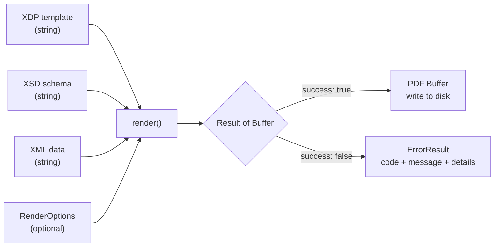
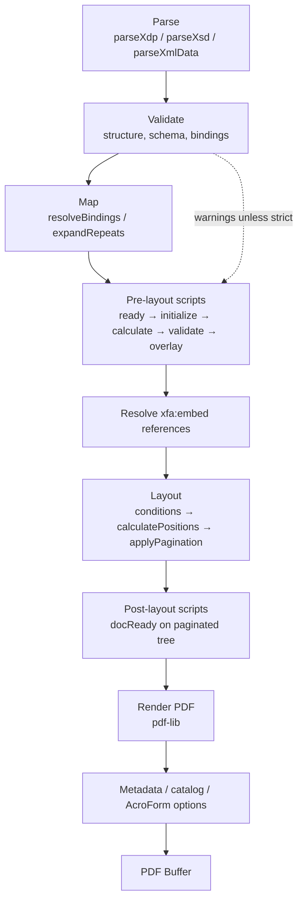
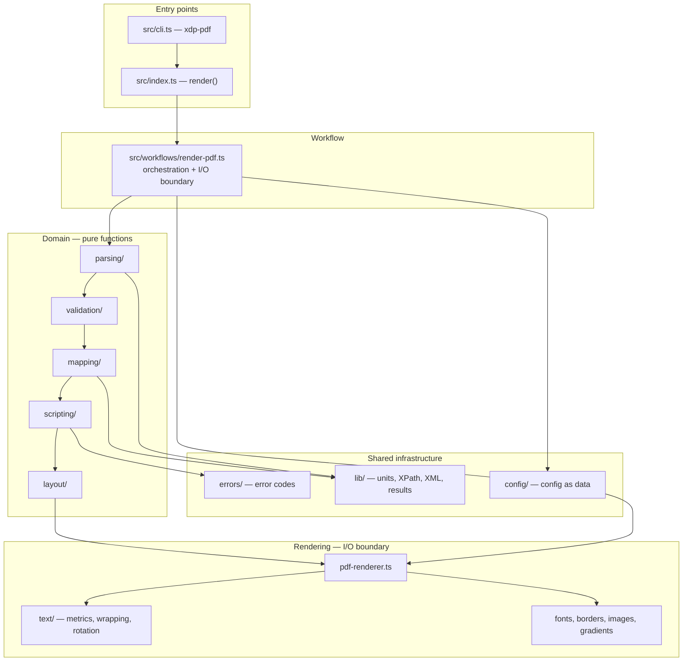
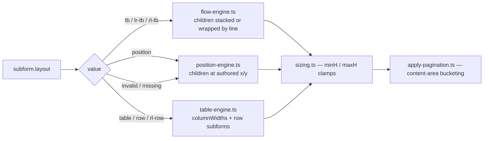
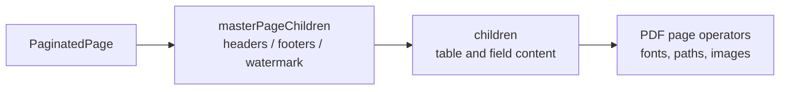
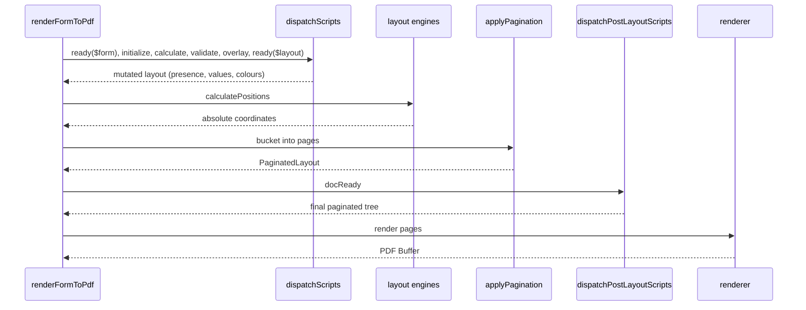
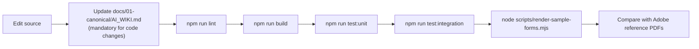

# @sanjay-sde/xdp-pdf-renderer

[](https://www.npmjs.com/package/@sanjay-sde/xdp-pdf-renderer)
[](LICENSE)
[](package.json)

> Render PDF documents from **XDP** templates, **XSD** schemas and **XML** data —
> entirely in Node.js, with no SAP or Adobe runtime dependency.

This is an educational passion project built to understand how Adobe LiveCycle
Designer / SAP Forms Service produce PDFs. It is not sold and is not affiliated
with either vendor. All real-world forms shipped as fixtures are sanitized
copies of private documents.

---

## Table of contents

- [Features](#features)
- [Installation](#installation)
- [Quick start](#quick-start)
- [CLI](#cli)
- [API reference](#api-reference)
- [How it works](#how-it-works)
- [Project structure](#project-structure)
- [Core concepts](#core-concepts)
- [Rendering fidelity and known limits](#rendering-fidelity-and-known-limits)
- [Development](#development)
- [For AI agents and contributors](#for-ai-agents-and-contributors)
- [License](#license)

---

## Features

- Pure Node.js conversion of XDP + XSD + XML to a PDF `Buffer`.
- Pure, side-effect-free domain layer with an explicit `Result<T>` error model.
- XFA template parsing: page areas, subforms, tables, fields, draws, borders,
  paragraphs, fonts, images, barcode and validation metadata.
- XSD-driven XML parsing with lexical decimal preservation (`0,006` stays
  `0,006`).
- Repeating subforms, conditional presence, and data binding resolution.
- FormCalc and JavaScript event scripting, SOM resolution, calculated fields
  and property-change cascades.
- Layout engines for flow (`tb`, `lr-tb`, `rl-tb`), absolute `position`, and
  `table`/`row` subforms, followed by pagination.
- PDF generation with font substitution, embedded images, borders, rich text,
  annotations, bookmarks, layers, metadata and optional AcroForm output.
- Regression suites and sanitized sample forms with Adobe-generated reference
  PDFs for visual comparison.

---

## Installation

```bash
npm install @sanjay-sde/xdp-pdf-renderer
```

Requirements: **Node.js >= 22.14.0** and npm.

The CLI is installed as `xdp-pdf` when the package is installed globally or
via `npx`:

```bash
npx xdp-pdf --help
```

---

## Quick start

```typescript
import { render } from '@sanjay-sde/xdp-pdf-renderer';
import { readFileSync, writeFileSync } from 'node:fs';

const result = await render({
  xdp: readFileSync('templates/invoice.xdp', 'utf8'),
  xsd: readFileSync('schemas/invoice.xsd', 'utf8'),
  data: readFileSync('data/invoice-001.xml', 'utf8'),
  options: {
    strictValidation: false,
    onWarning: (message) => console.warn(message),
  },
});

if (result.success) {
  writeFileSync('output/invoice.pdf', result.data);
  console.log('PDF generated successfully');
} else {
  console.error(`[${result.error.code}] ${result.error.message}`);
  for (const detail of result.error.details ?? []) console.error(`  - ${detail}`);
}
```



---

## CLI

```bash
# Render a PDF
xdp-pdf render --xdp template.xdp --xsd schema.xsd --data data.xml --output invoice.pdf

# Validate the inputs without rendering
xdp-pdf validate --xdp template.xdp --xsd schema.xsd --data data.xml

# Inspect the parsed XDP structure as JSON
xdp-pdf inspect --xdp template.xdp --output json
```

| Command | Required options | Optional options | Behaviour |
| --- | --- | --- | --- |
| `render` | `--xdp <file>`, `--xsd <file>`, `--data <file>` | `-o, --output <file>` (default `output.pdf`), `--lenient` | Writes the PDF, or exits `1` with code + details on failure. |
| `validate` | `--xdp <file>`, `--xsd <file>`, `--data <file>` | `--lenient` | Runs the full pipeline and prints `Validation passed.` |
| `inspect` | `--xdp <file>` | `-o, --output <format>` (default `json`) | Prints the parsed `LayoutModel` as pretty JSON. |

`--data -` reads XML from stdin in `render`. Missing files exit with code `2`.
`--lenient` sets `strictValidation: false`, so schema and binding problems are
reported as warnings instead of hard failures.

---

## API reference

### `render(input: RenderInput): Promise<Result<Buffer>>`

| Field | Type | Description |
| --- | --- | --- |
| `xdp` | `string` | XDP/XFA template XML. |
| `xsd` | `string` | XSD schema XML used to type the data. |
| `data` | `string` | XML data instance. |
| `options` | `RenderOptions` | Optional rendering configuration. |

### `Result<T>`

```typescript
type Result<T> =
  | { success: true; data: T }
  | { success: false; error: { code: string; message: string; details?: string[] } };
```

Always check `result.success` before reading `data` or `error`.

### `RenderOptions` (common fields)

| Option | Type | Default | Description |
| --- | --- | --- | --- |
| `strictValidation` | `boolean` | `true` | Hard-fail on schema/binding problems. `false` emits `onWarning` instead. |
| `onWarning` | `(message: string) => void` | no-op | Receives non-fatal validation warnings. |
| `maxInputSize` | `number` | library default | Upper bound for each XML input, in characters. |
| `fonts` | `Record<string, string>` | — | Family name to font-file path mapping. |
| `fontDirs` | `string[]` | — | Extra directories searched for fonts. |
| `pageHeight` | `number` | from template | Override the page height used by layout/pagination. |
| `skipScripts` | `boolean` | `false` | Skip all XFA scripts. |
| `skipScriptEvents` | `string[]` | — | Skip specific script events. |
| `previewMode` | `boolean` | `false` | Force invisible watermark nodes to render. |
| `adobe` | `AdobeOptions` | — | Security, bookmarks, annotations, layers, flattening, AcroForm, metadata. |

`AdobeOptions` supports `security` (user/owner passwords, permissions,
`rc4_40` / `rc4_128` / `aes_128`), `bookmarks`, `annotations`, `layers`,
`flatten`, `tabOrder`, `acroForm`, `tagged`, `embedXfa` and `metadata`
(`producer`, `creatorTool`).

`ERROR_CODES` is exported for machine-readable error handling.

---

## How it works

### End-to-end pipeline

The order is significant: scripts that change presence or values must run
before layout, and `docReady` must run after pagination.



### Layered architecture



### Layout engine selection



### Page rendering order

Master-page elements (titles, footers, logos, watermarks) are painted first so
content can cover them.



### Script lifecycle



---

## Project structure

```text
src/
├── index.ts                  public API: render(), types, ERROR_CODES
├── cli.ts                    xdp-pdf command line interface
├── types.ts                  shared domain and option types
├── workflows/
│   └── render-pdf.ts         pipeline orchestration
├── domain/                   pure functions, no I/O
│   ├── parsing/              XDP, XSD, XML, XLIFF and rich-text parsing
│   ├── validation/           structure, schema and binding validation
│   ├── mapping/              bindings, repeats, conditions, embeds
│   ├── scripting/            FormCalc, JS engine, SOM, events, property writes
│   └── layout/               flow, position, table engines, sizing, pagination
├── rendering/                pdf-lib output boundary
│   ├── pdf-renderer.ts       node → PDF operator dispatch
│   ├── text/                 line metrics, measurement, wrapping, rotation
│   ├── border-style.ts       dash / cap / join / corners
│   ├── font-*.ts             font registry, manager, substitution
│   └── image-*.ts            embed, scale, sniff, filters
├── lib/                      units, XPath, XML helpers, value format, results
├── adobe/                    security, AcroForm, annotations, bookmarks, layers
├── config/                   configuration as data
└── errors/                   error definitions and codes

test/
├── unit/                     pure-function and rendering regressions
├── integration/              workflow-level tests
├── fixtures/sample-forms/    sanitized forms + Adobe reference PDFs
└── helpers/                  PDF content extraction helpers

docs/
├── README.md                 documentation index
├── AGENTS.md                 naming scheme + mandatory research/plan rule
├── 01-canonical/AI_WIKI.md   source of truth for rationale and decisions
├── 02-research/              evidence, analysis and observations
├── 03-plans/                 implementation and parity plans
├── 04-decisions/             historical fix rationale
└── 05-reference/             observed Adobe rendering behaviour
.agents/skills/               installed JS/TS coding skills
reference/                    decompiled DLL evidence + observed behaviour
scripts/                      build, sanitize, font import, sample rendering
```

---

## Core concepts

| Term | Meaning in this library |
| --- | --- |
| **XDP** | XML Data Package containing the XFA template (and optional config/datasets). Parsed into a `LayoutModel`. |
| **XSD** | Schema describing the XML data. Drives typing of parsed values. |
| **XML data** | Instance data bound into fields through `<bind>` / SOM expressions. |
| **`LayoutModel`** | Normalized template tree plus page definitions, config and metadata. |
| **`PaginatedLayout`** | `LayoutModel` after absolute positioning and page bucketing. |
| **`Result<T>`** | Explicit success/error union; all domain functions return it. |
| **Subform** | Container with a `layout` mode: flow, position or table. |
| **Field / Draw** | Leaf nodes: interactive widgets or static text/images/shapes. |
| **Caption reserve** | Width Designer allocates to a field caption next to its value. |
| **Master page children** | Page-level headers, footers, logos and watermarks rendered before content. |

Design rules:

1. Domain functions are pure and return `Result<T>`.
2. `src/rendering/` is the only layer that emits PDF operators.
3. Fixes must be generic and derived from XFA semantics, reference output or
   decompiled evidence — never hard-coded to one fixture.
4. Source files contain no explanatory comments; rationale lives in the wiki.

---

## Rendering fidelity and known limits

The library targets Adobe LiveCycle Designer 11.0 "Preview as PDF" behaviour.
Evidence is recorded in [`reference/RENDERING_BEHAVIOR.md`](reference/RENDERING_BEHAVIOR.md)
and the decompiled material under [`reference/`](reference/).

Current known gaps:

- Pagination is a coordinate-bucketing approximation; complex flows can place
  one row on a different page than Adobe.
- The exact CoolType ascent for synthesised base-14 faces is unknown, leaving a
  residual ~1–2pt baseline drift in dense tables.
- `lineHeight` percentages and some `spaceAbove`/`spaceBelow` pagination
  interactions are not yet interpreted.

Visual comparisons use the sanitized forms in
[`test/fixtures/sample-forms/`](test/fixtures/sample-forms/README.md), where
`Adobe-generated-results/` holds the reference PDFs and `results/` holds this
library's output.

---

## Development

```bash
npm install
npm run build              # prettier --write src/ test/ → tsc → dist/
npm run lint               # eslint src --ext .ts --max-warnings 0
npm run test:unit          # fast unit + focused rendering regressions
npm run test:integration   # workflow-level tests
npm run test:coverage      # unit coverage summary (≥90% lines)
npm test                   # all suites

npm run sample-forms       # build + render sanitized fixtures
npm run verify             # build + scripts/verify-pdf.mjs
npm run format             # prettier --write src/ test/
npm run format:check       # prettier --check src/ test/
```



Contributions should add a regression test that fails without the fix, and
record the change in the wiki ledger.

---

## For AI agents and contributors

[`docs/01-canonical/AI_WIKI.md`](docs/01-canonical/AI_WIKI.md) is the **single source of truth** for
architecture, behaviour, and the rationale behind implementation decisions.
[`AGENTS.md`](AGENTS.md) is the short pointer agents read first.

- Read [`docs/README.md`](docs/README.md), then the wiki, before changing code.
- Non-trivial changes require a dated research note in `docs/02-research/` and
  a plan in `docs/03-plans/` **before** source edits.
- Load the relevant installed skill from `.skills/` before writing or
  reviewing code: `best-practices-ts`, `performance-ts`, `testing-ts`,
  `documentation-ts`, `audit-all-ts`, `node`, `linting-neostandard-eslint9`,
  `architecture-doc` and `readme-writer`.
  `.agents/skills/` contains symlinks only; rebuild with
  `bash scripts/sync-agent-skills.sh`.
- Source files intentionally have no explanatory comments; do not add them.
- After any code change, update the wiki in the same change: describe what
  changed and why, add a dated ledger entry, and record new or updated tests.
- Use the `reference/` folder as the Adobe oracle before inventing a fix.

---

## License

MIT © Sanjay Babu SP. See [LICENSE](LICENSE).
